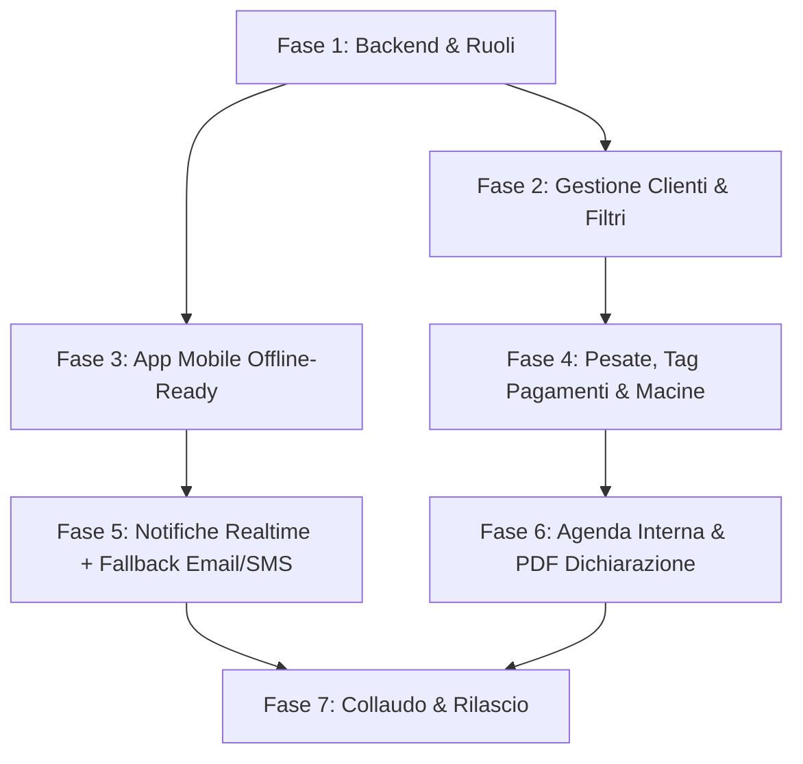

# 📋 Capitolato Requisiti & Specifiche Tecniche – Software Oleificio

> **Versione**: 2.0 (Definitiva per sviluppo)  
> **Data**: 18/10/2026  
> **Stato**: Approvato / Specifiche concordate  
> **Target**: Web Dashboard (PC Admin) + Mobile App (iOS & Android per Dipendenti/Admin)

---

## 🏗️ 1. Architettura di Sistema

```
┌────────────────────────────────────────────────────────────────────────┐
│                          ECOSISTEMA OLEIFICIO                          │
├───────────────────────────────────┬────────────────────────────────────┤
│         📱 APP MOBILE             │         🖥️ DASHBOARD PC            │
│       (iOS & Android)             │           (Web Admin)              │
│  • Ruolo: Dipendente & Admin      │  • Ruolo: Admin Esclusivo          │
│  • Operatività piazzale/pesate    │  • Dati sensibili & Finanze        │
│  • Coda offline / segnale debole  │  • Centro Notifiche in-app         │
├───────────────────────────────────┴────────────────────────────────────┤
│                       🔥 CLOUD BACKEND (Firebase)                      │
│  • Cloud Firestore (Sync Real-time + Caching offline)                 │
│  • Firebase Authentication (Ruoli Admin / Dipendente)                  │
│  • Cloud Functions + Gateway Email / SMS (Avvisi a PC spento)          │
│  • Cloud Storage (Archiviazione PDF dichiarazioni firmate)             │
└────────────────────────────────────────────────────────────────────────┘
```

---

## 👥 2. Gestione Ruoli & Permessi (RBAC)

> [!IMPORTANT]
> **Isolamento Dati Sensibili**: I dipendenti accedono unicamente alla parte operativa. Fatturato, incassi, saldi, documenti legali e dati fiscali riservati sono visibili e modificabili **soltanto dall'Account Admin**.

| Funzionalità / Dato | Dipendente (Mobile) | Admin (PC / Mobile) |
| :--- | :---: | :---: |
| Registrazione nuovo cliente (anagrafica base) | ✅ | ✅ |
| Creazione Partita & Registrazione Pesata | ✅ | ✅ |
| Assegnazione cassoni / bins | ✅ | ✅ |
| Consultazione stato lavorazione/molitura | ✅ (sola lettura) | ✅ (gestione completa) |
| Gestione Pagamenti & visualizzazione tag saldo | ❌ | ✅ |
| Generazione e visualizzazione PDF Dichiarazione | ❌ | ✅ |
| Consultazione Agenda & Storico clienti precedenti | ❌ (o limitato) | ✅ |
| Statistiche generali e metriche di resa | ❌ | ✅ |

---

## 📱 3. Lato Mobile (iOS & Android)

### 3.1 Piattaforma & Stack
- **Framework**: React Native (Expo) per garantire una singola codebase multipiattaforma ad alte prestazioni.
- **Supporto Scarsa Connettività / Segnale Debole**:
  - Implementazione di **persistenza locale e coda di sincronizzazione (Offline Queue)**.
  - Se nel piazzale o nei magazzini la copertura è instabile, l'operatore registra la pesata o la partita istantaneamente in locale.
  - Appena la connessione si stabilizza, l'app effettua l'invio automatico e silenzioso al cloud.
  - Indicatore visivo di stato rete: 🟢 *Connesso* | 🟡 *Dati in coda di sincronizzazione*.

### 3.2 Funzionalità Operatore
1. **Accoglienza & Nuova Partita**:
   - Selezione veloce del cliente tramite ricerca o inserimento rapido.
   - Creazione partita olive con timestamp automatico.
2. **Registrazione Pesate**:
   - Inserimento peso lordo / tara / peso netto cassoni.
   - Associazione immediata alla partita attiva.
3. **Trigger Notifica Istantanea**:
   - Ad ogni pesata o nuova partita salvata, parte l'evento di notifica verso il PC centrale e i canali esterni.

---

## 🖥️ 4. Lato PC – Dashboard Admin

### 4.1 Scheda Cliente Completa
Per ogni cliente, l'Admin visualizza un fascicolo digitale integrato:
- **Dati Anagrafici & Fiscali**: Nome, Cognome, Codice Fiscale / P.IVA, Telefono, Email, Indirizzo.
- **Stato Pagamenti Pesate**: Tag visivi colorati con storico acconti e saldi (cfr. §6).
- **Riepilogo Macine**: Numero totale macine, kg olive lavorati, resa olio stimata/effettiva.
- **Stato Molitura**: Data dell'ultima molitura e indicatore di stato (*In attesa*, *In lavorazione*, *Completata*).
- **Dichiarazione Primo Accesso**: Stato del documento (Generato, Stampato, Firmato/Archiviato).

### 4.2 Lista Clienti & Ricerca Avanzata con Filtri
Interfaccia tabellare avanzata con filtri combinabili:
- Ricerca testuale rapida (Nome, Cognome, Telefono, P.IVA).
- Filtro per **Stato Pagamento** (Non saldato, Parziale, Saldato).
- Filtro per **Stato Molitura** (Da molire, Molite recentemente).
- Filtro per **Range di Date** (Clienti con consegne nell'ultima settimana, mese, stagione corrente).
- Ordinamento per volume olive (kg totali) e frequenza visite.

---

## 🔔 5. Sistema Notifiche Multicanale (Mobile ➔ PC / Remoto)

Dato che il PC dell'oleificio non è costantemente presidiato o acceso:

```
[Azione su Mobile] (es. Nuova Pesata)
        │
        ▼
[Cloud Functions]
   ├──► 🖥️ PC Admin (se acceso): Notifica toast real-time + suono + badge contatore
   └──► 📬 PC Admin (se spento / Remoto): Notifica Email istantanea o SMS di riepilogo
```

1. **In-App Notification Center (PC)**:
   - Centro notifiche con campanella e badge non lette.
   - Avviso sonoro configurabile all'arrivo di una pesata.
   - Lista cronologica filtrabile delle operazioni fatte dai dipendenti.
2. **Canale Esterno di Fallback (Email / SMS)**:
   - Invio email istantanea all'Admin per ogni nuova partita o riepilogo giornaliero.
   - Predisposizione per notifica SMS/WhatsApp con i dati chiave dell'ingresso olive.

---

## ⚖️ 6. Gestione Pesate & Tag Pagamenti

Ogni registrazione di pesata è collegata al modulo contabile interno dell'Admin:

| Tag Stato | Colore | Significato & Requisiti |
| :--- | :---: | :--- |
| **Non Saldato** | 🔴 Rosso | Nessun versamento registrato per la pesata/partita. |
| **Acconto / Parziale** | 🟡 Giallo | Pagata quota parziale (obbligatorio: data acconto, importo versato, residuo calcolato). |
| **Saldato** | 🟢 Verde | Pagamento completato al 100% (obbligatorio: data saldo, metodo di pagamento, note). |

- Campo note contabili riservato all'Admin per annotazioni private.

---

## 📅 7. Agenda Interna & Monitoraggio Visite

- **Calendario Interattivo**:
  - Visualizzazione giornaliera, settimanale e mensile.
  - Pianificazione slot temporali per conferimento olive (evita code e colli di bottiglia al frantoio).
- **Storico Clienti Nei Giorni Precedenti**:
  - Registro rapido per verificare chi ha conferito olive nei giorni scorsi.
  - Monitoraggio dei tempi di giacenza delle olive prima della molitura (massimizzazione della qualità dell'olio).

---

## 📄 8. Modulo Dichiarazione Nuovi Utenti

- **Workflow al Primo Accesso**:
  1. Quando un nuovo cliente viene registrato, il software rileva l'assenza della dichiarazione.
  2. Viene generato automaticamente un **PDF precompilato** conforme al template condiviso via WhatsApp.
  3. Il documento viene stampato direttamente con un click.
  4. Il cliente appone la firma cartacea tradizionale.
  5. Possibilità per l'Admin di caricare una foto/scansione del foglio firmato all'interno della scheda cliente (archiviazione cloud sicura su Firebase Storage).

---

## 🫒 9. Riepilogo Macine & Molitura

Modulo analitico per ciascun cliente che visualizza:
- Contatore complessivo delle macine stagionali.
- Tabella dettaglio partite:
  - Codice identificativo partita e data arrivo.
  - Kg olive conferite e Tara cassoni.
  - Litri olio estratti e calcolo automatico della resa percentuale (`% resa = (kg olio / kg olive) * 100`).
  - Data e ora esatta di avvio e completamento molitura.

---

## 🗺️ 10. Roadmap di Sviluppo Suggerita



1. **Sprint 1 (Fondamenta & Sicurezza)**:
   - Configurazione Firebase Auth con ruoli (Admin vs Dipendente).
   - Estensione schema dati Firestore (Clienti, Partite, Pesate, Pagamenti, Notifiche).
2. **Sprint 2 (PC Admin - Anagrafica & Finanze)**:
   - Scheda cliente completa con filtri di ricerca avanzati.
   - Gestione tag pagamenti e contatore macine.
3. **Sprint 3 (App Mobile iOS/Android)**:
   - Interfaccia operatore per inserimento veloce partite/pesate.
   - Meccanismo di coda locale per connettività instabile.
4. **Sprint 4 (Notifiche & Automazioni)**:
   - Centro notifiche PC + trigger Cloud Functions per email/SMS alert.
   - Generazione automatica PDF dichiarazione precompilata.
5. **Sprint 5 (Agenda & Rifiniture)**:
   - Calendario appuntamenti e monitoraggio storico conferimenti.
